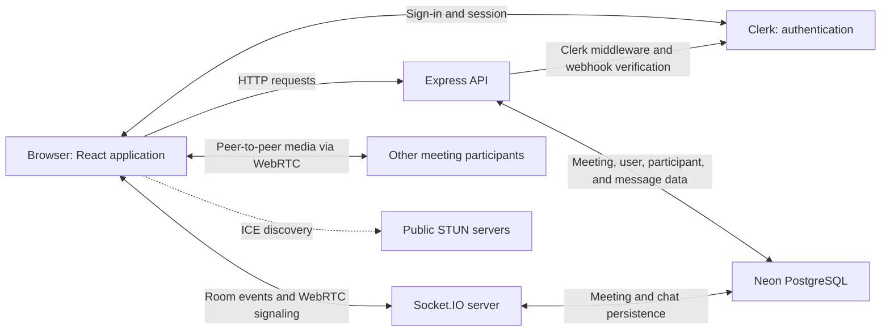
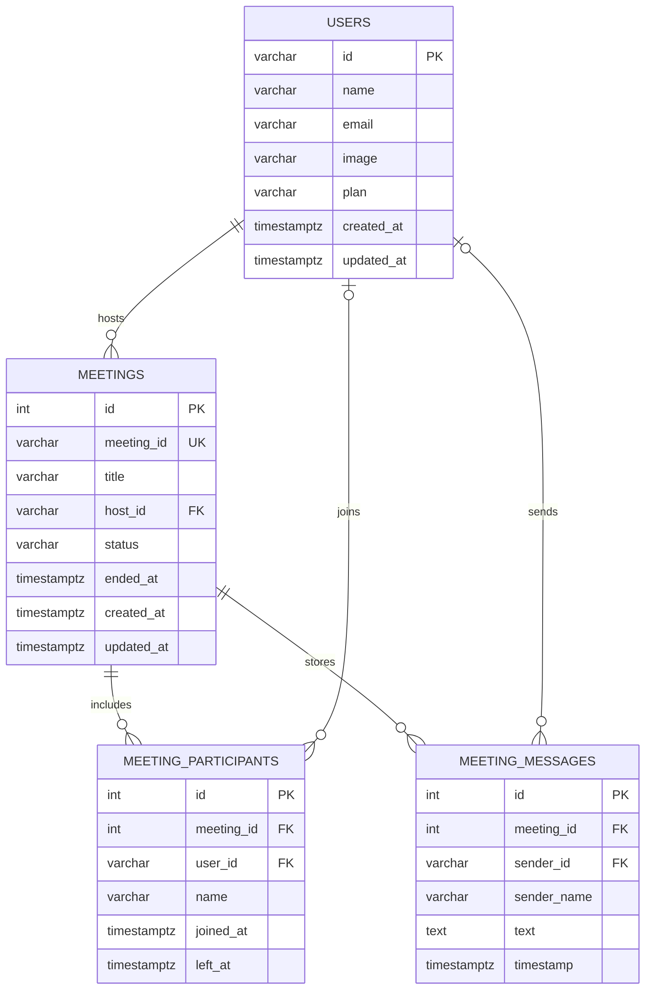

# MigoMeet

A browser-based meeting app for video calls, real-time chat, and meeting history.

[](https://react.dev/)
[](https://expressjs.com/)
[](https://socket.io/)
[](./LICENSE)

## Table of Contents

- [Overview](#overview)
- [Features](#features)
- [Technology Stack](#technology-stack)
- [Architecture](#architecture)
- [Project Structure](#project-structure)
- [Installation and Setup](#installation-and-setup)
- [Environment Variables](#environment-variables)
- [Usage](#usage)
- [API](#api)
- [Database Design](#database-design)
- [Contributing](#contributing)
- [License](#license)

## Overview

MigoMeet is a web application for creating and joining online meetings. It combines browser-based audio and video with real-time chat and a history of meeting participants and messages.

The project is intended for people who want a straightforward way to start or join a meeting, and for developers exploring an application built with React, Express, WebRTC, and Socket.IO.

## Features

### Meetings

- Create meetings with a generated meeting code.
- Join an active meeting using its code.
- Check meeting status before entering a room.
- Toggle local audio and video during a meeting.
- End a meeting for all participants from the host interface.

### Communication and history

- Establish peer-to-peer media connections using browser WebRTC APIs.
- Exchange WebRTC signaling through Socket.IO.
- Send real-time chat messages; meeting messages are stored in the database.
- Review meeting sessions, participants, and chat history.

### Accounts and plans

- Sign in and sign up through Clerk.
- Protect application pages and REST meeting endpoints with Clerk authentication.
- View plan information and meeting statistics.
- Enforce plan-based limits on the server: the free plan allows up to 30 meetings per month and 10 participants; the premium plan allows up to 100 participants and has no monthly meeting limit in the implemented checks.

## Technology Stack

| Area | Technologies |
|---|---|
| Frontend | React, Vite, Tailwind CSS, React Router |
| Backend | Node.js, Express |
| Real-time communication | Socket.IO |
| Audio/video | WebRTC browser APIs |
| Database | PostgreSQL through Neon’s serverless driver |
| Authentication | Clerk |
| Development tools | npm, Oxlint, Nodemon |

## Architecture

The React client uses Clerk for sign-in and sends HTTP requests to the Express API. The API initializes the PostgreSQL schema and reads and writes meeting, participant, and message records. Socket.IO relays room events and WebRTC signaling; media streams are negotiated between browsers using WebRTC.



## Project Structure

```text
MigoMeet/
├── client/
│   ├── public/                 # App icons, logo, and background images
│   ├── src/
│   │   ├── components/         # Shared UI, meeting, and session components
│   │   ├── config/             # API and Socket.IO client configuration
│   │   ├── hooks/              # WebRTC and chat hooks
│   │   ├── pages/              # Dashboard, login, meeting, pricing, sessions
│   │   ├── assets/             # UI asset references and sample data
│   │   ├── App.jsx             # Application routes
│   │   ├── index.css           # Global styles
│   │   └── main.jsx            # React and Clerk entry point
│   ├── package.json
│   └── vite.config.js
└── server/
    ├── config/db.js            # Neon connection and schema initialization
    ├── controllers/            # Meeting and Clerk webhook handlers
    ├── middleware/auth.js      # Clerk-backed REST route protection
    ├── routes/                 # Meeting REST routes
    ├── scripts/                # Clerk user synchronization script
    ├── services/               # User synchronization logic
    ├── server.js               # Express and Socket.IO server setup
    └── socket.js               # Meeting events and WebRTC signaling
```

## Installation and Setup

### Prerequisites

- Node.js and npm compatible with the versions required by the packages in `client/package.json`.
- A Clerk application configured for sign-in.
- A Neon PostgreSQL database.
- A Clerk webhook configured to send user events to the backend.

The repository does not pin a Node.js version.

### Clone the repository

```bash
git clone https://github.com/Pruthvi5559/MigoMeet.git
cd MigoMeet
```

### Install dependencies

Install the client and server dependencies separately:

```bash
cd client
npm install
cd ../server
npm install
```

### Configure environment variables

Create `server/.env` and `client/.env` using the variables listed in [Environment Variables](#environment-variables). Keep these files private and do not commit credentials.

For local development, set the client API URL to `http://localhost:3000` and allow the Vite origin, `http://localhost:5173`, in the server’s `ORIGINS` setting.

### Set up the database

Set `DATABASE_URL` to your Neon PostgreSQL connection string. On startup, the application creates the `users`, `meetings`, `meeting_participants`, and `meeting_messages` tables if they do not already exist.

### Start the application

In one terminal, start the backend:

```bash
cd server
npm run server
```

In a second terminal, start the frontend:

```bash
cd client
npm run dev
```

Vite prints the client URL when it starts. The backend defaults to `http://localhost:3000`.

## Environment Variables

| Variable | Used by | Required | Description |
|---|---|---:|---|
| `DATABASE_URL` | Server | Yes | Neon/PostgreSQL connection string. |
| `PORT` | Server | No | HTTP server port; defaults to `3000`. |
| `ORIGINS` | Server | Yes for separate client hosting | Comma-separated browser origins permitted by CORS and Socket.IO. |
| `CLERK_PUBLISHABLE_KEY` | Server | Yes for Clerk server integration | Clerk publishable key used by the server-side Clerk SDK. |
| `CLERK_SECRET_KEY` | Server | Yes for Clerk server integration | Clerk server secret key. Keep it private. |
| `CLERK_WEBHOOK_SIGNING_SECRET` | Server | Yes for webhook verification | Secret used to verify Clerk webhook requests. |
| `VITE_CLERK_PUBLISHABLE_KEY` | Client | Yes | Clerk publishable key; the client throws an error when it is missing. |
| `VITE_BASE_URL` | Client | Yes | Base URL used by the API and Socket.IO clients. Socket.IO defaults to `http://localhost:3000` if it is omitted. |

The repository does not include an environment-variable example file. Obtain Clerk credentials and webhook signing secrets from your Clerk configuration. Do not place secret keys in client-side `VITE_` variables.

## Usage

1. Open the client in a browser and sign in or register.
2. From the dashboard, create a meeting or enter an existing meeting code.
3. Allow camera and microphone access when prompted. If camera access fails, the client attempts to start with audio only.
4. Use the meeting controls to toggle audio/video, open chat or participant details, leave, or end the meeting as host.
5. Visit the sessions page to review meeting history and details.

## API

All `/api/meetings` endpoints below are protected by Clerk authentication and expect a valid Clerk session token in the `Authorization` header. The Clerk webhook endpoint is verified separately.

| Method | Path | Purpose | Request | Authentication |
|---|---|---|---|---|
| `GET` | `/` | Check that the API is running. | None | None |
| `POST` | `/api/meetings` | Create a meeting. Accepts an optional JSON `title`. | `{ "title": "Project sync" }` | Clerk |
| `GET` | `/api/meetings/stats` | Get the current user’s plan and meeting statistics. | None | Clerk |
| `GET` | `/api/meetings/sessions` | List sessions hosted by or attended by the current user, including participants and messages. | None | Clerk |
| `GET` | `/api/meetings/sessions/:id` | Get details for a session accessible to the current user. `:id` is the meeting code. | None | Clerk |
| `GET` | `/api/meetings/:meetingId` | Look up a meeting by code and check whether it is active. | `:meetingId` is the meeting code. | Clerk |
| `POST` | `/api/clerk` | Receive Clerk user webhooks for `user.created`, `user.updated`, and `user.deleted`. | Clerk webhook JSON payload | Clerk webhook signature |

### Example: create a meeting

```http
POST /api/meetings
Content-Type: application/json
Authorization: Bearer <clerk-session-token>
```

```json
{
  "title": "Project sync"
}
```

The response includes a `meeting` object with its database ID, generated meeting code, title, host, status, and creation time.

### Example: meeting statistics response

```json
{
  "plan": "free",
  "monthlyCount": 4,
  "monthlyLimit": 30,
  "maxParticipants": 10
}
```

The values above are illustrative. Premium users receive `monthlyLimit: null` and `maxParticipants: 100`.

## Database Design

The server connects to PostgreSQL using `@neondatabase/serverless`. It initializes the schema at startup.



## Contributing

Contributions are welcome.

1. Fork the repository.
2. Create a focused branch:

   ```bash
   git switch -c feat/your-change
   ```

3. Make and verify your changes.
4. Commit your changes and push the branch to your fork.
5. Open a pull request describing the change.

## License

This project is licensed under the Apache License 2.0. See the [LICENSE file](https://github.com/Pruthvi5559/MigoMeet/blob/main/LICENSE) for the full text.
